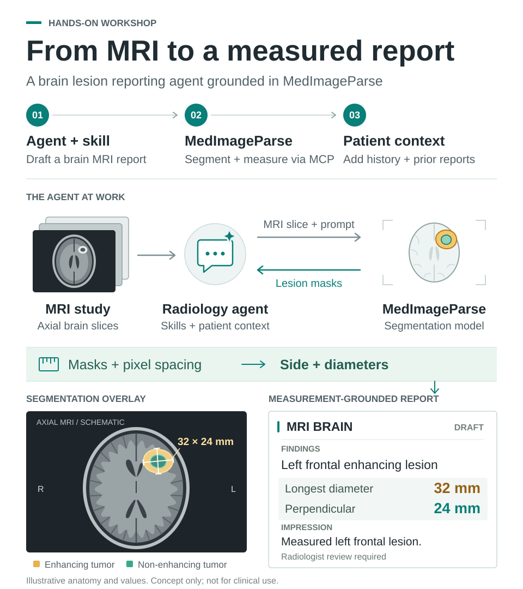

# How to Actually Use Foundation Models: From Segmentation to Agents

**Microsoft Ignite 2026 hands-on lab.** This repository supports a hands-on lab on building **radiology AI agents** in VS Code with GitHub Copilot, grounded in **MedImageParse** — a foundation model that segments medical images from simple text prompts. The lab follows one brain MRI case from a bare LLM to a measured, context-aware report, and is organized into **three chapters**, each in its own folder under [`chapters/`](chapters/).

Budget about **30 min setup** (do this before arriving) + **60 min content** across the three chapters.

> 🚧 **Work in progress for Ignite 2026.** The lab structure, agents, skills, and MCP server scaffolding are in place, and the source MRI case has been selected. The MedImageParse calls, lesion measurement code, exported PNG slices, and eval results are placeholders — search the repo for `Placeholder` and `TODO(mip)` to find them.



## What you'll build

1. **Chapter 1 — Simple agent + skill** ([`chapters/chapter1-simple-agent/`](chapters/chapter1-simple-agent/)): use a general-purpose LLM with a prompt-based skill to draft structured brain MRI reports — and see where it falls short.
2. **Chapter 2 — Using foundation models with agents** ([`chapters/chapter2-foundation-models/`](chapters/chapter2-foundation-models/)): wrap MedImageParse lesion segmentation, plus a measurement tool that turns masks into millimeters, in an MCP server the agent can call.
3. **Chapter 3 — Patient context** ([`chapters/chapter3-knowledge-sources/`](chapters/chapter3-knowledge-sources/)): ground agent outputs in a (synthetic) patient history and a prior report, so the agent reports interval change.

## Workshop layout

- [`chapters/`](chapters/) — one folder per chapter. Each has a `README.md`, a `starter/` skeleton, and an `answer-key/` reference.
- [`samples/`](samples/) — brain MRI you can hand to the agent: a glioblastoma follow-up case from MU-Glioma-Post (CC BY 4.0), available as NIfTI volumes, DICOM series, and per-slice PNGs. See [samples/README.md](samples/README.md).
- [`eval-results/`](eval-results/) — reference scoring numbers for the chapter-to-chapter comparisons (🚧 placeholder — see [eval-results/README.md](eval-results/README.md)).
- [`docs/`](docs/) — troubleshooting, Codespaces, and no-admin setup guides.

> The data and patient records in this repo are synthetic or de-identified and are **not for clinical use**. The brain MRI comes from the [MU-Glioma-Post](https://doi.org/10.7937/7K9K-3C83) dataset on The Cancer Imaging Archive, used under [CC BY 4.0](https://creativecommons.org/licenses/by/4.0/). See [samples/nifti/README.md](samples/nifti/README.md) for the required citation. The patient chart wrapped around it is fictional. MedImageParse is provided for research and model development exploration; it is not designed or intended to be deployed in clinical settings as-is.

## Prerequisites

Install and verify the following **before** the workshop. Expect about 30 minutes of setup. Do this before arriving — Wi-Fi and time will be tight on the day.

> 🚧 **Placeholder — lab environment.** Confirm whether Ignite attendees get a pre-provisioned lab VM or bring their own machine, and trim this section accordingly.

- **VS Code** (latest stable): https://code.visualstudio.com/
- **GitHub Copilot** and **GitHub Copilot Chat** extensions, signed in with an account that has Copilot access.
- **Git**, and a local clone of this repository opened as your VS Code workspace.
- **uv** (https://docs.astral.sh/uv/) — Python package manager. Install user-scope (no admin required):
  - **macOS / Linux:** `curl -LsSf https://astral.sh/uv/install.sh | sh`
  - **Windows (PowerShell):** `powershell -ExecutionPolicy ByPass -c "irm https://astral.sh/uv/install.ps1 | iex"`

  Then run `uv sync` from the repo root.

Can't install locally? See [docs/no-admin.md](docs/no-admin.md) or run the whole lab in a [GitHub Codespace](docs/codespaces.md).

### MedImageParse credentials

Chapter 2 calls a shared MedImageParse endpoint. Credentials (`MIP_MODEL_ENDPOINT` and `MIP_MODEL_API_KEY`) are distributed at the start of the session. You'll set them up in Chapter 2 Setup; the working path will be `mcp/medimageparse-server/.env` at workspace root.

### Quick check

The `workshop/` directory at repo root holds shared Python utilities for the workshop, including a small script to verify your env is healthy.

```bash
uv --version              # 0.x.x
uv sync                   # one-time, ~1–2 min on a good connection
uv run workshop/check_env.py   # expected: "Workshop env OK — Python 3.11"
```

If any command above fails, resolve it before arriving.