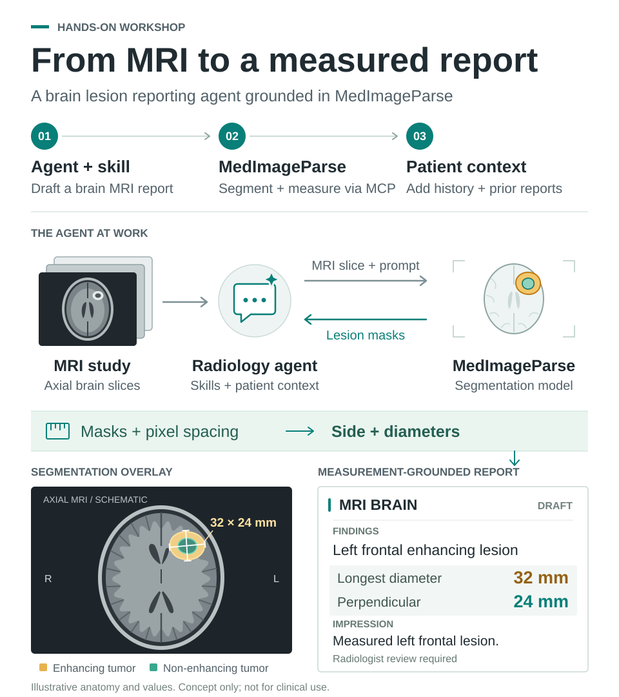

# Build Healthcare Agents with Foundation and Reasoning Models

**Hands-on workshop.** This repository supports a hands-on workshop on building **radiology AI agents** in VS Code with GitHub Copilot, grounded in **MedImageParse** — a foundation model that segments medical images from simple text prompts. The lab follows one brain MRI case from a bare LLM to a measured, context-aware report, and is organized into **three chapters**, each in its own folder under [`chapters/`](chapters/).

Budget about **30 min setup** (do this before arriving) + **45 min content** across the three chapters.

> [!IMPORTANT]
> **This lab depends on a custom model.** It calls a MedImageParse 3D model that we fine-tuned to segment brain tumors on post-contrast T1 MRI, using data from [UPENN-GBM](https://www.cancerimagingarchive.net/collection/upenn-gbm/). During the lab at Ignite 2026, we provided access to this model. The lab does not work without this custom model. To run the lab, you can:
>
> - **Fine-tune your own.** Follow the [MedImageParse 3D fine-tuning example](https://github.com/microsoft/healthcareai-examples/tree/main/azureml/medimageparse3d/finetuning) to fine-tune, evaluate, and deploy the model with Azure Machine Learning. Use UPENN-GBM as we did, or a different dataset.
> - **Ask us for access.** Contact [hlsfrontierteam@microsoft.com](mailto:hlsfrontierteam@microsoft.com), and we can provide access to the model.
>
> Then copy `.env.example` to `.env` at the repository root and fill in the values it describes. If you deploy your own model, either name the deployment `mip3d-mri-brain-lesion`, or change `deployment` in both Chapter 2 `models.json` files (`starter/` and `answer-key/`) and run `uv run workshop/check_env.py --deployment <your-deployment>`.



## What you'll build

1. **Chapter 1 — Simple agent + skill** ([`chapters/chapter1-simple-agent/`](chapters/chapter1-simple-agent/)): use a general-purpose LLM with a prompt-based skill to draft structured brain MRI reports — and see where it falls short.
2. **Chapter 2 — Using foundation models with agents** ([`chapters/chapter2-foundation-models/`](chapters/chapter2-foundation-models/)): wrap MedImageParse lesion segmentation, plus a measurement tool that turns masks into millimeters, in an MCP server the agent can call.
3. **Chapter 3 — Patient context** ([`chapters/chapter3-knowledge-sources/`](chapters/chapter3-knowledge-sources/)): ground agent outputs in a (synthetic) patient history and a prior report, so the agent reports interval change.

## Workshop layout

- [`chapters/`](chapters/) — one folder per chapter. Each has a `README.md`, a `starter/` skeleton, and an `answer-key/` reference.
- [`samples/`](samples/) — de-identified post-contrast brain MRI volumes (NIfTI) you can hand to the agent. See [samples/README.md](samples/README.md).
- [`docs/`](docs/) — troubleshooting, Codespaces, and no-admin setup guides.

> The data and patient records in this repo are synthetic or de-identified and are **not for clinical use**. The patient charts in Chapter 3 are synthetic. MedImageParse is provided for research and model development exploration; it is not designed or intended to be deployed in clinical settings as-is.

## Prerequisites

Install and verify the following **before** the workshop. Expect about 30 minutes of setup. Do this before arriving — Wi-Fi and time will be tight on the day.

- **VS Code** (latest stable): https://code.visualstudio.com/
- **GitHub Copilot** and **GitHub Copilot Chat** extensions, signed in with an account that has Copilot access.
- **Git** with **Git LFS** (https://git-lfs.com/), and a local clone of this repository opened as your VS Code workspace. The sample scans are stored with Git LFS: run `git lfs install` once before cloning, or `git lfs pull` in a clone that has small text files in place of the `.nii.gz` scans.
- **uv** (https://docs.astral.sh/uv/) — Python package manager. Install user-scope (no admin required):
  - **macOS / Linux:** `curl -LsSf https://astral.sh/uv/install.sh | sh`
  - **Windows (PowerShell):** `powershell -ExecutionPolicy ByPass -c "irm https://astral.sh/uv/install.ps1 | iex"`

  Then run `uv sync` from the repo root.

Can't install locally? See [docs/no-admin.md](docs/no-admin.md) or run the whole lab in a [GitHub Codespace](docs/codespaces.md).

### MedImageParse credentials

Chapter 2 calls a shared MedImageParse endpoint. Credentials (`MIP_MODEL_ENDPOINT` and `MIP_MODEL_API_KEY`) are distributed at the start of the session. Copy `.env.example` to `.env` at the repository root and fill them in; the quick check below and the Chapter 2 MCP server both read that file.

### Quick check

The `workshop/` directory at repo root holds shared Python utilities for the workshop, including a small script to verify your env is healthy.

```bash
uv --version              # 0.x.x
uv sync                   # one-time, ~1–2 min on a good connection
uv run workshop/check_env.py   # expected: "Workshop env OK — Python 3.11; endpoint OK (mip3d-mri-brain-lesion)"
```

If any command above fails, resolve it before arriving if you would like to follow along.
