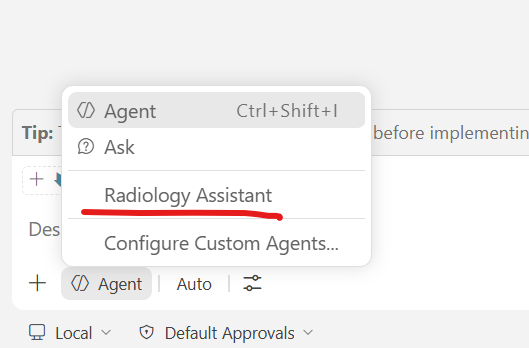

# Chapter 1 — Simple agent with a skill

**Time budget: ~12 minutes.**

> Stuck? See [docs/troubleshooting.md](../../docs/troubleshooting.md).

**Prerequisites:** Workshop-level setup from the repo root [`README.md`](../../README.md) complete — VS Code with the GitHub Copilot Chat extension signed in, this repo cloned and open as your workspace, and `uv sync` run from the repo root. When you open the workspace in VS Code, confirm that it's a **trusted workspace** when prompted.

## Overview

In this chapter you will build a minimal "radiology assistant" agent inside VS Code that uses a general-purpose LLM (no specialized foundation model yet) to generate a structured report from a brain MRI image. The point is to feel how *cheap* and *easy* it is to compose an agent from skills — and to see, by the end, that a generic LLM is **not** clinically reliable on its own.

We start with a very simple agent, without any skills, and progress by adding a skill to start seeing better conformance.

A "Radiology Assistant" agent built on a generic LLM will happily produce a brain MRI report, but it is not clinically reliable: section names drift run-to-run, hedging language is inconsistent, confidence is never stated — and, worst of all for brain lesions, it will quote lesion sizes in millimeters that it has no way to measure. In this chapter you build that bare agent, watch it drift, then close the gap by adding a single **skill** — a structured, reusable instruction packet that gives the agent a fixed report template, phrasing discipline, a "no invented numbers" rule, and calibrated confidence buckets. By the end you'll see the same agent produce a consistent report on the same image.

**Steps:**

0. Setup — copy the starter agent file to your workspace. (~1 min)
1. See the gap — run the bare agent and note where structure drifts and numbers appear from nowhere. (~4 min)
2. Add the skill — copy the Chapter 1 skill and read how it's built. (~4 min)
3. Activate it — copy in the agent whose workflow calls the skill, then rerun. (~3 min)
4. (Optional) Phrase bank additions.

> **Build it yourself (optional).** The steps copy the Chapter 1 skill and agent from `answer-key/`. To write them yourself instead, start from the skill with TODOs in `starter/.github/skills/write-report-simple/`; [suggested-changes.md](suggested-changes.md) has text for each TODO and for the agent's workflow step.

## Setup (~1 min)

Copy the starter agent file into your workspace `.github/agents/` so VS Code picks it up:

You can do it manually or use the command line script.
```bash
# from repo root
mkdir -p .github/agents
cp chapters/chapter1-simple-agent/starter/.github/agents/radiology-assistant.agent.md .github/agents/radiology-assistant.agent.md
```

Inspect the file and observe how it contains instructions constraining the agent, but doesn't have much specific radiological guidance. In Step 3 you'll replace it with a version whose workflow calls a skill.

## Step 1 — See the gap (~4 min)

Open Copilot Chat. With the agent definition file in place you should be able to select our new agent. In the agent picker, switch to **Radiology Assistant**.



Send:

```
Please write a radiology report for samples/mri-brain-lesions/case-056/2017-06-13/series-0018.nii.gz.
```

> Remember, the agent **only accepts file paths**. Don't drag the image into chat or use the paperclip; if you do, it'll refuse.

When VS Code first asks for permission to run a tool, select **Allow All**.

Note a few things:
- **Output drift.** Notice that section names drift and the structure is unpredictable. If it reports lesion sizes, they don't come from a measurement tool; the model estimates or invents them.
- **Inconsistency**. Run it a few times. Note how output changes. Note how every time generated code is a bit if not significantly different. Try asking it to measure the lesion.

Keep the output visible — you'll compare against it after Step 3.

> **Other images to try (optional).** Run the same prompt on `samples/mri-brain-lesions/case-056/2018-04-14/series-0902.nii.gz` or `samples/mri-brain-lesions/case-062/2021-06-25/series-0007.nii.gz`, or rerun the first image to see how much the output changes from run to run.

## Step 2 — Add the skill (~4 min)

Skills live at `.github/skills/<skill-name>/`. Copy the Chapter 1 skill into place:

```bash
mkdir -p .github/skills
cp -r chapters/chapter1-simple-agent/answer-key/.github/skills/write-report-simple .github/skills/
```

That gives you two files:

```
.github/skills/write-report-simple/
  SKILL.md                    ← the skill body
  references/phrase-bank.md   ← example wordings the skill reads on demand
```

The skill **name** (frontmatter `name:` and the directory name) must match exactly.

Open `SKILL.md` and read it top to bottom. What each part does:

- **`description`** (frontmatter). The agent matches this string against the task at hand to decide whether to invoke the skill. Specific beats categorical — vague descriptions get ignored.
- **`argument-hint`** (frontmatter). Declares optional inputs other agents or later chapters may pass in. Chapter 1 passes none, but declaring them makes the skill an interface with a contract, not just a prompt. In Chapter 2 the skill receives real outputs from a segmentation model (`findings`) and a measurement tool (`measurements`).
- **Opening lines.** What the skill does and doesn't do (no tools, no measuring, no priors), then the order of trust for inputs: explicit `confidence`, then tool-supplied `findings` and `measurements`, then the agent's own read of the image. Tool `measurements` are copied verbatim.
- **Budget.** No tool calls and at most 200 words, so the skill stays a writing step and the report stays short.
- **How to use.** The report layout and the rules for each section, plus a link to `references/phrase-bank.md`. The agent reads supporting files like the phrase bank only when it needs them.
- **Style rules.** When the agent has options, the skill picks one and names it. These rules close the gaps that cause run-to-run drift in hedging language and sentence structure — and add two rules specific to brain lesions: **numbers come from tools only**, and **laterality is the patient's**.
- **Output format.** Machine-readable output needs a verbatim template, not a description of one. The literal `<confidence>` and `<report>` tags let downstream steps extract the confidence value without fragile string matching.

## Step 3 — Activate it (~3 min)

The skill exists, but your agent's workflow still drafts reports on its own. Compare your agent file with the Chapter 1 agent in `answer-key/`:

- yours: `.github/agents/radiology-assistant.agent.md`
- answer key: `chapters/chapter1-simple-agent/answer-key/.github/agents/radiology-assistant.agent.md`

(In Explorer, right-click one file and choose **Select for Compare**, then right-click the other and choose **Compare with Selected**.)

The only difference is the `<workflow>` block: steps 2 and 3 ("Analyze the image", "Draft the report") become one step that invokes `write-report-simple` and returns its output unchanged. Copy the answer-key agent over yours:

```bash
cp chapters/chapter1-simple-agent/answer-key/.github/agents/radiology-assistant.agent.md .github/agents/radiology-assistant.agent.md
```

Start a new chat and run the Step 1 prompt on the same image, this time naming the skill:

```
/write-report-simple Please write a radiology report for samples/mri-brain-lesions/case-056/2017-06-13/series-0018.nii.gz.
```

The output should now:
- Use EXAM, INDICATION, COMPARISON, TECHNIQUE, FINDINGS, and IMPRESSION in order, with a blank line between sections and text on the first four header lines
- Have one prose paragraph for FINDINGS and numbered IMPRESSION statements, one per line
- Open with `<confidence>...</confidence>` on its own line, then `<report>...</report>`
- Describe lesion size qualitatively ("large", "moderate") instead of quoting invented millimeters
- Borrow phrasings you can find in `references/phrase-bank.md`

If it still looks like Step 1, the agent didn't pick up the skill. Check: directory name = `write-report-simple` exactly, both files exist, and the workflow step names `write-report-simple`. It also helps to start a new chat session.

Read the report against your own impression. Where does it go right? Where does it go wrong? Notice that the skill made the agent *honest* about size — but it still can't tell you *how big* the lesion is. That's Chapter 2.

> **Other images to try (optional).** Run `/write-report-simple` on the other images from Step 1 and compare each with its Step 1 report.

> **Ways skills get invoked.** Here the agent's workflow names `write-report-simple`, so the agent calls it for every report. Without that step, an agent can still pick up a skill automatically when its `description` matches the request, or you can name it with `/<skillname>` (`/write-report-simple Please write a radiology report for …`). Explicit is useful when a skill's description is ambiguous or when several skills could plausibly handle the request. Typing `/` in the chat input lists the registered skills, which is a good way to check that yours was picked up.

Takeaway: a general-purpose LLM looking at pixels is not clinically reliable; a small skill restores the structure, phrasing discipline, and stated confidence the workflow needs — and stops it from inventing measurements. It can't *add* the measurements, though.

## (Optional) Step 4 — Extra credit

**Add to the phrase bank.** Pick a finding the bank doesn't cover well (for example, a specific white matter lesion pattern or an extra-axial collection) and add 2–3 example phrasings (positive / possible / negative) under a new section in `references/phrase-bank.md`. Start a fresh chat, re-run `/write-report-simple Please write a radiology report for samples/mri-brain-lesions/case-056/2017-06-13/series-0018.nii.gz.`, and see whether the agent borrows your wording.

## What you should have at the end

- [ ] `.github/skills/write-report-simple/{SKILL.md, references/phrase-bank.md}`
- [ ] `.github/agents/radiology-assistant.agent.md` with a workflow step that calls `write-report-simple`
- [ ] An "after" report from Step 3 you can put next to the "before" from Step 1

## What's next

In Chapter 2 you'll give the agent **eyes and a ruler**. You'll wire **MedImageParse** — a prompt-based medical image segmentation foundation model — into the agent through a custom MCP server, then add a measurement tool that turns its lesion masks into millimeters. Every lesion in the report will then trace back to an actual mask, and every size to actual code, instead of the LLM guessing from pixels.