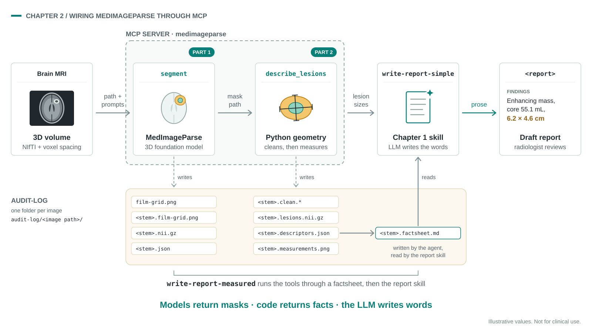

# Chapter 2 — Using foundation models with agents

**Time budget: ~40 minutes.**

> Stuck? See [docs/troubleshooting.md](../../docs/troubleshooting.md).

**Prerequisites:** Chapter 1 complete, with `.github/agents/radiology-assistant.agent.md` and the `write-report-simple` + `summarize-eval` skills under `.github/skills/` at your workspace root.

> 🚧 **Placeholder — MedImageParse integration in progress.** The MCP server in this chapter is wired end to end, but the MedImageParse call (`segmentation.segment`) and the measurement code (`measurement.measure`) are stubs that raise `NotImplementedError` until the implementation lands. Everything up to "the tool shows up and the agent calls it" works today; the tool results do not yet.

## Overview

In Chapter 1 you saw that a generic LLM, even with a carefully engineered prompt, is unreliable on real brain MRI: it can't reliably say *whether* there is a lesion, and it has no way to say *how big* it is. The way an agent skill becomes something more than a prompt is by adding **tools**. In this chapter you give the agent *eyes and a ruler* by wiring it to **MedImageParse** — a foundation model that segments medical images from simple text prompts — through a small **MCP (Model Context Protocol) server**. Tools are essentially Python functions that describe what they do and what their inputs and outputs are directly in their type hints and docstrings.



This chapter has two halves. In **Part 1** you wire a segmentation tool: send an image and prompts like `enhancing tumor`, get back lesion masks. In **Part 2** you wire a measurement tool on top of the same masks: plain Python that turns mask pixels into the patient's side and diameters in millimeters. By the end you'll have seen both on the same image, and you'll understand why the numbers in a report should come from code, not from the LLM.

| | Segment (Part 1) | Measure (Part 2) |
|---|---|---|
| What it is | MedImageParse foundation model | Plain Python geometry on the mask |
| Input | Image path + text prompts | Mask path (from Part 1) |
| Output | Mask file per prompt + detected flag | Side + diameters (mm) per lesion |
| Answers | "Is there a lesion?" | "Which side, and how big?" |

Two design choices to notice along the way:

- **Return handles, not pixels.** `segment_lesions` writes each mask to disk and returns its *path*. A 1024×1024 mask is a million numbers — the agent doesn't need them in its context window, and the next tool only needs to know where the file is.
- **Models return pixels; code returns facts; the LLM writes words.** Each layer does the one thing it's reliable at.

**Steps:**
- Setup — copy starter files, configure `.env`. (~5 min)

**Part 1 — Segment**

1. Wire the `segment_lesions` tool. (~6 min)
2. Skim the segmentation skill. (~2 min)
3. Try it on a sample brain MRI. (~6 min)
4. Compare Chapter 1 vs Part 1. (~2 min)

**Part 2 — Measure**

5. Why measurements come from code. (~1 min)
6. Wire the `measure_lesions` tool. (~3 min)
7. Skim the measured-report skill. (~2 min)
8. Try it on the same sample. (~5 min)
9. Compare Part 1 vs Part 2. (~3 min)

**(Optional) Extra credit.**

## Setup (~5 min)

**Copy the starter files** into your workspace root:

```bash
cp -r chapters/chapter2-foundation-models/starter/. .
cp    mcp/medimageparse-server/.env.example \
      mcp/medimageparse-server/.env
```

That gives you the following additions at workspace root. This is a **one-time setup** — no further file copying mid-chapter:

```
.github/
  agents/radiology-assistant.agent.md      ← from Chapter 1 (you'll edit this in Part 1, Step 1)
  skills/
    write-report-segmentation/             ← skill ships filled in — you'll skim it in Part 1
      references/prompts.md                ← the brain lesion prompt sets
    write-report-measured/                 ← skill ships filled in — you'll skim it in Part 2
mcp/medimageparse-server/                  ← MCP server with TWO TODOs
  server.py                                ← TODO 1 (segment), TODO 2 (measure)
  segmentation.py                          ← MedImageParse call + prompt catalog (read-only)
  measurement.py                           ← mask → side + millimeters (read-only)
  prompt_examples.json
  .env.example
.vscode/
  mcp.json                                 ← server registered, ready to go
```

**Fill in your `.env`.** Open `mcp/medimageparse-server/.env` and paste in the endpoint and API key from your instructor:

```
MIP_MODEL_ENDPOINT=<get from your instructor>
MIP_MODEL_API_KEY=<get from your instructor>
```

## Part 1 — Segment

Start with the model: a thin wrapper around a MedImageParse call.

### Step 1 — Wire the `segment_lesions` tool (~6 min)

Open `mcp/medimageparse-server/server.py` and find the **first TODO**. The pattern is already shown above it: `prompt_examples` is a working example, a thin wrapper that delegates to a function in `segmentation.py` and pulls its docstring through the decorator.

Replace the first TODO with:

```python
@mcp.tool(description=segmentation.segment.__doc__)
def segment_lesions(file_path: str, prompts: list[str]) -> dict[str, dict]:
    return segmentation.segment(file_path, prompts)
```

Three things matter here:

- **Decorator.** `@mcp.tool(...)` registers the function with the server. Without it, the function is invisible to the agent.
- **Type hints.** MCP uses them to build the tool schema the agent sees. `file_path: str` and `prompts: list[str]` are required.
- **`description=segmentation.segment.__doc__`** — reuses `segment`'s docstring as the tool description, so the agent gets the prompt-format guidance and the return contract for free.

Save and confirm the tool registers. The MCP server auto-reloads (or reload manually with `Cmd/Ctrl+Shift+P` → `MCP: Reload Servers`). Open the chat tool picker (configuration icon next to the model selector) and confirm **`segment_lesions`** appears under **medimageparse** alongside `prompt_examples`. Once the `.vscode/mcp.json` is in place, VS Code launches the server and interrogates it for tools — it may take a moment.

> If the tool doesn't appear, check **Output → MCP → medimageparse** for syntax errors.

Open `.github/agents/radiology-assistant.agent.md` (from Chapter 1) and add `medimageparse/*` to the `tools:` list:

```yaml
tools: [execute, read, agent, browser, edit, search, web, todo, medimageparse/*]
```

This unlocks both `segment_lesions` and (after Part 2) `measure_lesions` for the agent. While you're in the file, replace the Chapter 1 routing line (`For brain MRI reports use skill write-report-simple`) so the agent reaches for the tool-backed skills first:

```markdown
- For brain MRI reports, use the most capable report skill whose tools are available: `write-report-measured` (segmentation and measurement tools), else `write-report-segmentation` (segmentation tool only), else `write-report-simple`.
```

No further agent-file edit is needed in this chapter.

### Step 2 — Skim the segmentation skill (~2 min)

The MCP tool is wired, but the agent still needs a skill that tells it *when* to call it and *what to do with the result*. That skill ships filled in. Open `.github/skills/write-report-segmentation/SKILL.md` and skim:

- **Frontmatter `description`** — scopes the skill to brain MRI when the segmentation tool is available; this is what the agent reads when deciding to load it.
- **The two-step contract** — (a) call `mcp_medimageparse_segment_lesions(file_path, prompts)` and read off which targets were detected, (b) hand the findings to the `write-report-simple` skill (from Chapter 1) and return what it returns. The report itself stays clean of model attribution — that's a rule in the `write-report-simple` style guide.
- **`references/prompts.md`** — the prompt sets the skill passes in, chosen by MRI sequence. MedImageParse is prompted with short target names (`enhancing tumor`, `edema`), not sentences.

*Tool-name note:* VS Code prefixes MCP tools with `mcp_<server>_` and shortens long server names (a server named `medimageinsight`, for example, shows up as `medimageinsig`). `medimageparse` is short enough to stay intact, so the tool ID should be `mcp_medimageparse_segment_lesions`. If your tool picker shows a different alias, that's the one the agent uses.

### Step 3 — Try it (~6 min)

Switch the chat agent to **Radiology Assistant** and ask:

```
Please write a radiology report for samples/SYN0417_003.png.
```

VS Code will ask for permissions to run third-party code — confirm each prompt.

Watch the trace: you should see one `mcp_medimageparse_segment_lesions` call, then `write-report-simple` invoked, then the final report. Every lesion component the report mentions should trace back to a prompt that came back `detected: true`. The `<report>` block should read like a radiologist's note — no masks, no prompts, no mention of MedImageParse. And notice what's still missing: the report describes the lesion as "large" or "moderate", because nothing has *measured* it yet.

> 🚧 **Placeholder.** Until `segmentation.segment` is implemented, the tool call returns a `NotImplementedError`. You can still verify the wiring: the agent should *attempt* the call with an absolute path and the prompts from `references/prompts.md`.

> First-call latency: the MedImageParse endpoint runs on a GPU and may take 30–90s to wake up if it's been idle. Subsequent calls are fast.

> If the agent writes a report without calling MedImageParse first, `segment_lesions` may not be registered. Check the tool picker under **medimageparse**.

> **Why this matters.** The `write-report-simple` skill is unchanged from Chapter 1, and the agent file only gained a tool list entry and a routing line. You added a new vision capability by registering an MCP tool — no agent rewrite, no skill rewrite. That's the architectural promise of MCP: add tools, don't change the harness.

### Step 4 — Compare Chapter 1 vs Part 1 (~2 min)

Eval results for both chapters ship under `eval-results/`. Use the `/summarize-eval` skill from Chapter 1:

```
/summarize-eval, compare these two evals:
baseline: eval-results/chapter1
candidate: eval-results/chapter2-segment
```

> 🚧 **Placeholder — eval results pending.** See [eval-results/README.md](../../eval-results/README.md).

Look at lesion detection first: with presence coming from MedImageParse masks instead of the LLM's impression of the pixels, detection sensitivity and specificity should move — that's where grounding shows up. Report-text scores may barely move; the LLM was already a fluent writer. Even where the overall numbers look similar, the grounding path is now model output rather than LLM inference. The same wrapper pattern works for any model you want to add.

## Part 2 — Measure

Segmentation is one tool. Measurement is another — and it isn't a model at all. A mask says *which pixels* are lesion; turning that into "left, 32 × 24 mm" needs pixel spacing (which lives in image metadata, not in the pixels), connected-component analysis, and a little geometry. Deterministic code does that exactly, every time, and you can unit-test it. An LLM eyeballing the image does it approximately, differently each run, and can't be tested.

### Step 5 — Why measurements come from code (~1 min)

Brain tumors are tracked over time by size on axial images: the **longest diameter** of the enhancing lesion and the **longest diameter perpendicular to it**. Whether a tumor is growing, stable, or shrinking between two scans comes down to comparing those numbers — so they have to be real. Two things make that hard for an LLM:

- **Millimeters aren't in the pixels.** Each sample ships with a sidecar JSON holding its pixel spacing (e.g. 0.9 mm per pixel). The measurement tool reads it; the LLM never sees it.
- **Left and right are flipped on screen.** Brain MRI uses radiological convention — the patient's right is on the image left. The measurement tool applies that rule in code, every time.

### Step 6 — Wire the `measure_lesions` tool (~3 min)

Open `mcp/medimageparse-server/server.py` and find the **second TODO**. The pattern is identical to Step 1:

```python
@mcp.tool(description=measurement.measure.__doc__)
def measure_lesions(mask_path: str) -> dict:
    return measurement.measure(mask_path)
```

Same `@mcp.tool` decorator, same type-hint discipline, same docstring-as-description trick. The only changes are the module (`measurement` instead of `segmentation`) and the input: a `mask_path` — the output of `segment_lesions`. Tools chain through file paths.

Reload the server (`Cmd/Ctrl+Shift+P` → `MCP: Reload Servers`) and confirm **`measure_lesions`** now appears in the tool picker alongside `segment_lesions`. The agent already has `medimageparse/*` access from Step 1 — no further agent-file edit needed.

> If `measure_lesions` doesn't appear, check **Output → MCP → medimageparse** for an import error.

### Step 7 — Skim the measured-report skill (~2 min)

Open `.github/skills/write-report-measured/SKILL.md`. The key teaching beat: the skill calls `segment_lesions`, passes the primary target's `mask_path` to `measure_lesions`, and hands the result to `write-report-simple` as `measurements` — to be copied **verbatim**. The LLM never computes, rounds, or converts a number, and when its own read of the image disagrees with the tool about which side the lesion is on, the tool wins. That's what "grounded" means for numbers.

### Step 8 — Try it (~5 min)

Same prompt as Part 1:

```
Please write a radiology report for samples/SYN0417_003.png.
```

The agent now has both tools available. The measured skill's `description` and the routing rule in the agent file steer it toward `write-report-measured`. Watch the trace for `mcp_medimageparse_segment_lesions` followed by `mcp_medimageparse_measure_lesions`, see the returned side and diameters, and check that the report quotes exactly those numbers.

> 🚧 **Placeholder.** Until `measurement.measure` is implemented, the measurement call returns a `NotImplementedError`.

### Step 9 — Compare Part 1 vs Part 2 (~3 min)

```
/summarize-eval, compare these two evals:
baseline: eval-results/chapter2-segment
candidate: eval-results/chapter2-measure
```

> 🚧 **Placeholder — eval results pending.** See [eval-results/README.md](../../eval-results/README.md).

Detection shouldn't change much — both runs use the same masks. What should move is everything numeric and spatial: laterality accuracy and measurement error. That's the headline: a foundation model gave the agent perception, but it took a few dozen lines of ordinary code to turn perception into facts a report can stand on.

## (Optional) Extra credit

1. **Try other prompts.** Ask the agent to call `prompt_examples` and pick prompts for a different target (for example `edema` on a FLAIR image), then pass them as `extra_prompts`. MedImageParse takes arbitrary target names at call time — watch which ones it finds and which come back empty.

2. **Look at the mask.** Ask the agent to overlay the mask from `outputs/masks/` on the source image with matplotlib and save the result as a PNG, then open it. Seeing what the model actually segmented is the fastest way to build (or lose) trust in it.

3. **Go 3D.** 🚧 *Placeholder.* **MedImageParse 3D** segments whole MRI or CT volumes (NIfTI) instead of single slices. Swapping it in means a different `segmentation.py` and a `measure_lesions` that reports volume in milliliters — the server shape, the skills, and the agent stay the same.

## What you should have at the end

- [ ] `mcp/medimageparse-server/.env` with `MIP_MODEL_ENDPOINT` and `MIP_MODEL_API_KEY` filled in
- [ ] `segment_lesions` and `measure_lesions` both wired in `server.py` and visible in the tool picker
- [ ] `medimageparse/*` in the agent's `tools:` list, and the report-skill routing line updated
- [ ] A grounded report from Part 1 Step 3 (every lesion component traces to a detected mask)
- [ ] A measured report from Part 2 Step 8 (side and diameters copied from `measure_lesions`)
- [ ] `summarize-eval` run once for Chapter 1 vs Part 1 (Step 4), once for Part 1 vs Part 2 (Step 9)

If you got stuck, the completed version of every file is in `chapters/chapter2-foundation-models/answer-key/`.

## What's next

In Chapter 3 you'll give the agent **context**. A real brain MRI follow-up read depends on more than pixels: the diagnosis, the surgery, when radiation finished, and what the lesion measured last time. You'll give the agent access to a synthetic patient record and watch the same image produce a different report once the agent can see the chart.